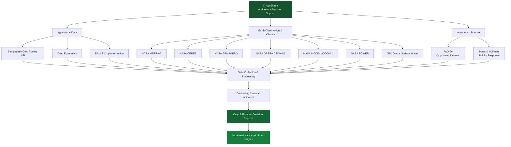
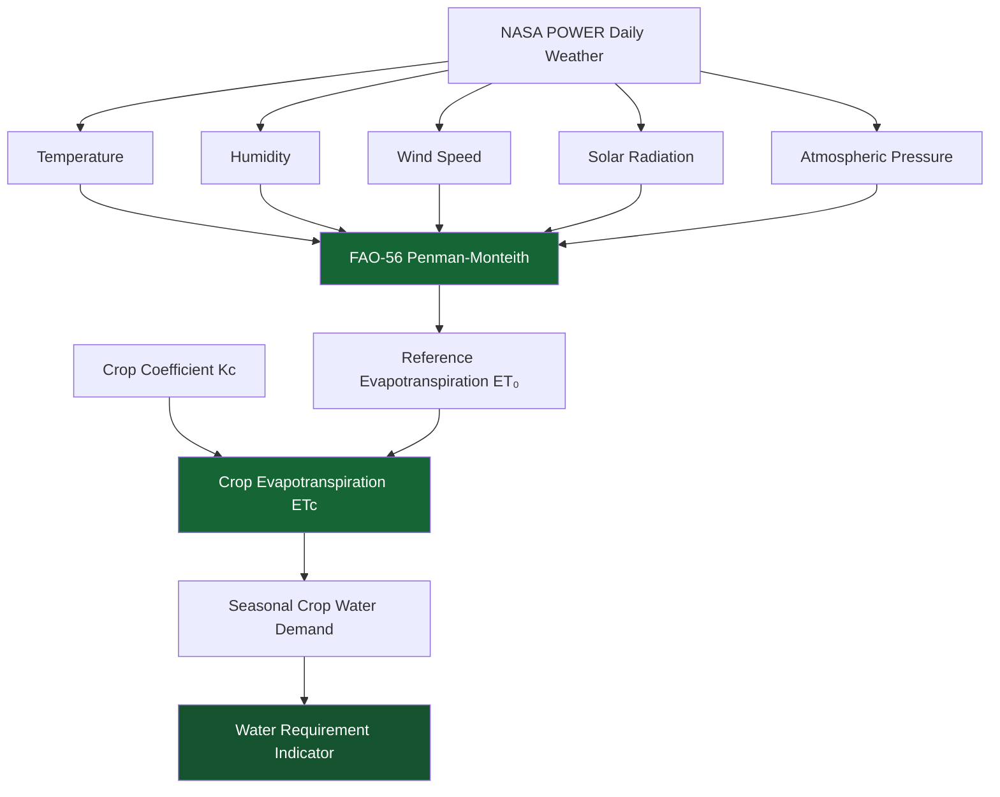
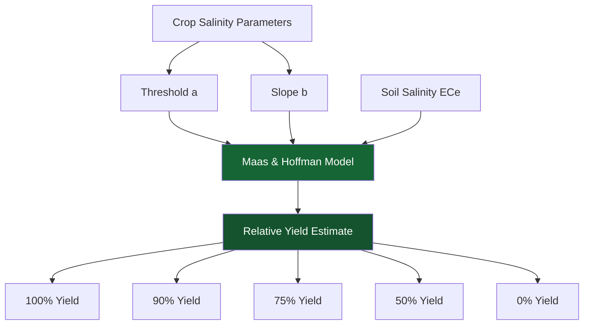
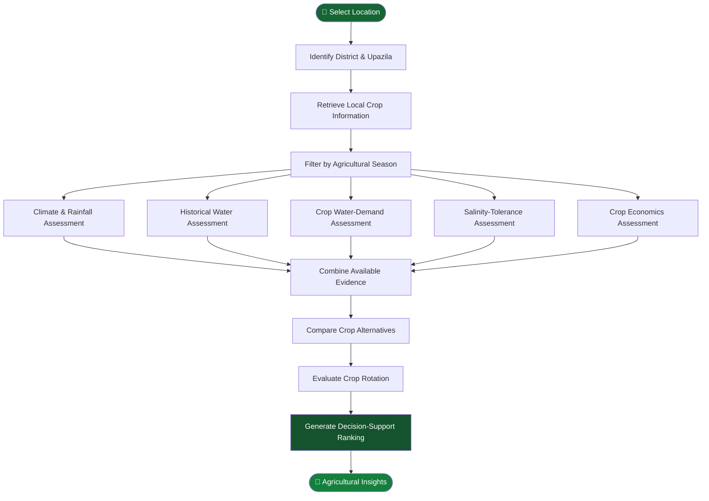

# 🌾 AgriSheba
### Intelligent Agricultural Decision Support for Bangladesh

<p align="center">
  <strong>Connecting Earth Observation, Agricultural Intelligence & Agronomic Science</strong>
</p>

<p align="center">
  <a href="https://github.com/ismailmazumder/agree_sheba">
    
  </a>
  
  
  
</p>

<p align="center">
  <a href="https://github.com/ismailmazumder/agree_sheba/stargazers">
    
  </a>
  <a href="https://github.com/ismailmazumder/agree_sheba/network/members">
    
  </a>
  
  
</p>

---

## 🌍 Overview

**AgriSheba** is an experimental agricultural decision-support project designed to explore data-driven crop selection and crop-rotation planning in Bangladesh.

It combines agricultural information from Bangladesh government sources, satellite observations from NASA, meteorological datasets, and established agronomic methodologies from the Food and Agriculture Organization (FAO).

The project's central idea is to connect different dimensions of agricultural decision-making:

- 🌱 Crop suitability and seasonal compatibility
- 🌧️ Rainfall and climate conditions
- 💧 Crop evapotranspiration and water demand
- 🛰️ Satellite-derived environmental indicators
- 🌊 Historical surface-water and possible inundation signals
- 🧂 Crop salinity tolerance
- 💰 Agricultural economic indicators
- 🔄 Crop diversity and rotation planning

Instead of treating crop selection as a single-variable problem, AgriSheba explores how multiple environmental, agricultural, and economic indicators can support more informed decisions.

> **Research principle:** Every recommendation should be traceable to its underlying data, calculation, and assumptions. Satellite-derived indicators and theoretical crop models must not be confused with direct field measurements.

---

## 🧭 Project at a Glance

| Attribute | Description |
|---|---|
| Project | AgriSheba |
| Domain | Agricultural decision support |
| Geographic focus | Bangladesh |
| Primary application | Crop suitability and crop-rotation assessment |
| Agricultural data | Bangladesh Crop Zoning APIs |
| Earth observation | NASA and JRC |
| Meteorological data | NASA MERRA-2 and POWER |
| Rainfall data | NASA GPM IMERG |
| Agronomic models | FAO-56 and Maas & Hoffman |
| Processing | Python, pandas, NumPy, xarray, Google Earth Engine |
| Interface | HTML-based project files |

## ✨ Core Capabilities

| Capability | Scientific or data foundation |
|---|---|
| Crop suitability assessment | Bangladesh Crop Zoning |
| Crop economics comparison | Government crop-economics records |
| Climate assessment | NASA MERRA-2 and POWER |
| Rainfall analysis | NASA GPM IMERG and POWER |
| Flood-related assessment | NASA OPERA DSWx-S1 and JRC |
| Vegetation-water analysis | MODIS MOD09A1 and LSWI |
| Crop water demand | FAO-56 Penman–Monteith |
| Salinity tolerance | Maas & Hoffman response model |
| Crop rotation exploration | Crop-season and diversity indicators |

---

# 🏗️ System Architecture

AgriSheba follows a multi-source data architecture.

The data from different providers are collected and processed separately, then transformed into agricultural indicators that can support decision-making.



### Data processing philosophy

AgriSheba distinguishes between four types of information:

1. **Source observations:** Original information obtained from data providers.
2. **Derived indicators:** Calculations performed on original observations.
3. **Agronomic parameters:** Scientific coefficients and thresholds.
4. **Decision outputs:** Comparisons or rankings generated from available evidence.

This separation is important because a theoretical crop tolerance threshold, for example, is not equivalent to a measured soil condition.

---

# 🛰️ Data Sources

AgriSheba integrates agricultural, meteorological, satellite, and agronomic information.

## 1. Bangladesh Crop Zoning APIs

<sub>Source: Bangladesh Agricultural Research Council / Crop Zoning Project</sub>

**Base URL:** `https://api1.cropzoning.gov.bd/api`

The Bangladesh Crop Zoning API is the primary source of location-specific agricultural suitability and economic information.

### API endpoints

| Endpoint | Purpose |
|---|---|
| `/crop-suitability-upazilas/{district_code}` | Upazila information |
| `/ceupazilas/{district_code}` | Crop-economics upazila information |
| `/crop-suitability/{upazila_code}` | Crop suitability |
| `/crop-economics/getEcData/{upazila_code}` | Crop economic information |

### Collected information

- Crop names in English and Bangla
- Crop seasons
- Crop suitability categories
- Crop varieties and situations
- Gross margin
- Benefit-cost-related indicators
- District and upazila identifiers

### Suitability classification

| Classification | Meaning |
|---|---|
| VS | Very Suitable |
| S | Suitable |
| MS | Moderately Suitable |
| LS | Less Suitable |
| NS | Not Suitable |

**Implementation:** `data/datacollect/gov/mighty_crop_data.py`

**References:**
- [Crop Zoning Portal](https://cropzoning.gov.bd/)
- [Crop Suitability Portal](https://portal.cropzoning.gov.bd/cropSuitability)
- [Crop Zoning Information System](https://czis.cropzoning.gov.bd/)

---

## 2. BAMIS — Agricultural Meteorological Information

<sub>Source: Bangladesh Agro-Meteorological Information Service</sub>

[Official website](https://www.bamis.gov.bd/)

The repository contains crop-specific agricultural calendar references and weather-related information.

Available information includes:

- Crop growth stages
- Weekly weather information
- Disease information
- Insect pest information
- Weather warnings
- Crop-specific agricultural references

BAMIS information is used as supplementary agricultural context.

**Implementation:** `data/datacollect/gov/each_crop_data/`

**Provenance note:** The repository contains BAMIS references and processed crop information, but a complete reproducible download pipeline for every record has not been established.

---

## 3. NASA MERRA-2

<sub>Dataset: Modern-Era Retrospective Analysis for Research and Applications, Version 2</sub>

[Official NASA documentation](https://gmao.gsfc.nasa.gov/reanalysis/MERRA-2/)

MERRA-2 is a global atmospheric reanalysis dataset.

### Variables represented in the local dataset

| Variable | Description |
|---|---|
| T2M | Temperature at 2 metres |
| QV2M | Specific humidity |
| PS | Surface pressure |
| GWETTOP | Surface soil wetness |

### Applications

- Atmospheric temperature assessment
- Humidity analysis
- Environmental characterization
- Soil-wetness context

**Local dataset:** `data/datasets/cumilla_nasa_data.csv`

The committed local snapshot is labelled for Cumilla and covers 2025.

The exact extraction coordinates and unit-conversion history require additional provenance documentation.

---

## 4. NASA CERES

<sub>Dataset: Clouds and the Earth's Radiant Energy System</sub>

[Official NASA documentation](https://ceres.larc.nasa.gov/)

The repository's environmental CSV contains a variable labelled:

`ALLSKY_SFC_UV_INDEX`

The local file attributes it to CERES SYN1deg All Sky Surface UV Index.

### Application

Provides an additional radiation-related environmental indicator.

The source variable's exact physical meaning and unit conversion should be verified against the original product documentation before scientific interpretation.

**Local dataset:** `data/datasets/cumilla_nasa_data.csv`

---

## 5. NASA GPM IMERG

<sub>Dataset: Integrated Multi-satellitE Retrievals for GPM</sub>

[Official NASA GPM portal](https://gpm.nasa.gov/data/imerg)

**Product version:** V07B

IMERG combines satellite precipitation estimates to produce precipitation information across the globe.

### Processing

The project works with daily NetCDF4 files following the pattern:

`3B-DAY.MS.MRG.3IMERG.*.V07B.nc4`

The notebook processes daily observations into monthly and seasonal summaries.

### Derived indicators

- Monthly rainfall
- Mean monthly rainfall
- Median monthly rainfall
- Wet-day frequency
- Rainy-day frequency
- Monsoon-onset-related statistics

A wet day is defined using a threshold of 1 mm/day.

**Implementation:** `data/datacollect/nasa/rain_imperg/imerg_monthly/summary.ipynb`

**Derived output:** `data/datasets/season.csv`

**Important:** The existing summary uses a reference coordinate near Dhaka rather than Cumilla and does not establish a long-term national rainfall climatology.

---

## 6. NASA OPERA DSWx-S1

<sub>Dataset: Dynamic Surface Water Extent from Sentinel-1</sub>

[Google Earth Engine catalog](https://developers.google.com/earth-engine/datasets/catalog/OPERA_DSWX_L3_V1_S1)

**Earth Engine ID:**

`OPERA/DSWX/L3_V1/S1`

OPERA DSWx-S1 provides satellite-derived surface-water classification using Sentinel-1 radar observations.

### Processing methodology

The script extracts:

- Binary water detections
- Valid observation counts
- Possible inundation frequency
- Permanent-water comparison

The basic frequency calculation is:

\[
F=\frac{N_{\text{water}}}{N_{\text{valid}}}\times100
\]

Where:

- \(F\) = Water detection frequency
- \(N_{\text{water}}\) = Water detections
- \(N_{\text{valid}}\) = Valid observations

JRC Global Surface Water is used as a complementary permanent-water reference.

**Implementation:** `data/datacollect/nasa/flood/calculate_location_flood_signal.py`

**Output:** `data/datasets/location_flood_assessment.csv`

This is a historical surface-water indicator, not a flood forecasting model.

---

## 7. JRC Global Surface Water

<sub>Provider: European Commission Joint Research Centre</sub>

[Google Earth Engine catalog](https://developers.google.com/earth-engine/datasets/catalog/JRC_GSW1_4_GlobalSurfaceWater)

**Dataset ID:**

`JRC/GSW1_4/GlobalSurfaceWater`

The project uses the `occurrence` band to examine historical surface-water occurrence.

### Application

JRC provides complementary historical information for interpreting OPERA water detections.

This helps distinguish repeated water signals from locations that are already characterized by persistent surface water.

---

## 8. NASA MODIS MOD09A1

<sub>Dataset: MODIS/Terra Surface Reflectance 8-Day L3 Global 500m</sub>

[Official Google Earth Engine catalog](https://developers.google.com/earth-engine/datasets/catalog/MODIS_061_MOD09A1)

**Dataset ID:** `MODIS/061/MOD09A1`

### Bands used

| Band | Purpose |
|---|---|
| B02 | Near-infrared reflectance |
| B06 | Shortwave-infrared reflectance |
| QC | Quality-control filtering |

### Land Surface Water Index

The project calculates LSWI:

\[
LSWI=\frac{NIR-SWIR}{NIR+SWIR}
\]

For the implemented bands:

\[
LSWI=\frac{B02-B06}{B02+B06}
\]

### Application

LSWI provides an indicative vegetation-water signal that can be examined across available observation dates.

**Implementation:** `data/datacollect/nasa/lswi/lwsi.ipynb`

**Spatial resolution:** 500 metres.

**Temporal resolution:** 8-day composite.

LSWI should not be interpreted as a direct soil-moisture measurement or a locally validated crop-stress measurement.

---

## 9. NASA POWER

<sub>Service: Prediction of Worldwide Energy Resources</sub>

[Official NASA POWER portal](https://power.larc.nasa.gov/)

NASA POWER supplies meteorological and solar-related information used in several project workflows.

### Parameters

| Parameter | Description |
|---|---|
| T2M | Temperature at 2 metres |
| T2M_MAX | Maximum temperature |
| T2M_MIN | Minimum temperature |
| T2MDEW | Dew-point temperature |
| RH2M | Relative humidity |
| WS2M | Wind speed at 2 metres |
| WS10M | Wind speed at 10 metres |
| PRECTOTCORR | Corrected precipitation |
| PS | Surface pressure |
| ALLSKY_SFC_SW_DWN | All-sky surface shortwave downward radiation |

### Applications

- Historical meteorological analysis
- Rainfall assessment
- Reference evapotranspiration
- Crop water-demand calculations

**Implementation:**

- `data/datacollect/nasa/nasa_power/power.py`
- `data/datacollect/nasa/rain_mean/rain_mean.py`
- `data/datacollect/nasa/crop_water_demand/add_crop_water_demand.py`

The historical weather workflows are configured for 2001–2024, while the monthly location collector uses 2024.

---

# 🧪 Agronomic Models

AgriSheba incorporates two important scientific methodologies for evaluating agricultural constraints.

These methodologies provide calculated indicators rather than direct measurements.

## 1. FAO-56 — Crop Water Demand

**Reference:** Allen et al. (1998), FAO Irrigation and Drainage Paper 56.

[Read the official FAO publication](https://www.fao.org/4/x0490e/x0490e00.htm)

### Scientific workflow



### Reference evapotranspiration

The FAO-56 Penman–Monteith equation is:

\[
ET_0=
\frac{
0.408\Delta(R_n-G)+
\gamma\frac{900}{T+273}u_2(e_s-e_a)
}{
\Delta+\gamma(1+0.34u_2)
}
\]

Where:

- \(ET_0\): Reference evapotranspiration
- \(R_n\): Net radiation
- \(G\): Soil heat flux
- \(T\): Mean air temperature
- \(u_2\): Wind speed at 2 metres
- \(e_s\): Saturation vapour pressure
- \(e_a\): Actual vapour pressure
- \(\Delta\): Vapour-pressure curve slope
- \(\gamma\): Psychrometric constant

### Crop evapotranspiration

\[
\boxed{ET_c=K_c\times ET_0}
\]

Crop coefficients are represented for:

- Initial growth stage
- Mid-season growth stage
- End-season growth stage

### Derived outputs

- Seasonal average ET₀
- Crop-specific ETc
- Daily water demand
- Eight-day water-demand estimate
- Seasonal rainfall comparison
- Water demand in mm and m³/ha

Unit conversion:

\[
1\text{ mm over 1 hectare}=10\text{ m}^3
\]

**Implementation:** `data/datacollect/nasa/crop_water_demand/add_crop_water_demand.py`

**Output:** `data/datasets/crops_data_with_water_demand.csv`

### Limitation

ETc is not equivalent to irrigation requirement. Effective rainfall, soil-water storage, runoff, irrigation efficiency, and other field conditions are not fully represented.

---

## 2. Maas & Hoffman — Crop Salinity Response

**Scientific reference:** Maas and Hoffman (1977), *Crop Salt Tolerance—Current Assessment*.

[FAO Water Quality for Agriculture](https://www.fao.org/4/T0234e/T0234E03.htm)

### Purpose

Different crops have different tolerance levels to salinity.

The Maas & Hoffman model describes the relationship between root-zone soil salinity and relative crop yield.

### Mathematical model

\[
Y=100-b(EC_e-a)
\]

Where:

| Symbol | Description |
|---|---|
| \(Y\) | Relative yield (%) |
| \(EC_e\) | Soil saturation extract electrical conductivity |
| \(a\) | Crop salinity threshold |
| \(b\) | Yield reduction slope |

### Model interpretation



### Crop parameters

The implementation includes crop-specific parameters for:

- Barley
- Cotton
- Wheat
- Soybean
- Sugar beet
- Sugarcane
- Maize
- Sunflower
- Sorghum
- Boro rice
- T. Aman rice
- T. Aus rice

### Derived thresholds

For a target relative yield \(Y_t\):

\[
EC_{e,target}=a+\frac{100-Y_t}{b}
\]

The code calculates theoretical thresholds for 100%, 90%, 75%, 50%, and 0% relative yield.

**Implementation:** `data/datacollect/nasa/crop_salt_tola/main.py`

**Output:** `data/datasets/crops_data_with_salt_tolerance.csv`

**Important:** These are crop tolerance parameters. They are not measurements of the salinity of a particular farm. Field-specific ECe measurements are necessary for a meaningful quantitative comparison.

---

# 🔄 Crop Decision-Support Workflow

The intended decision-support workflow combines local crop information with environmental and agronomic indicators.



**Implementation note:** This diagram describes the intended research workflow, not a claim that every processing component is already connected to the current application. The public repository contains separate processing scripts and derived datasets; the complete runtime application and its integration need further verification.

---

# 📊 Dataset Comparison

| Dataset | Provider | Spatial resolution | Main application |
|---|---|---:|---|
| Crop Zoning | Bangladesh | Administrative | Crop suitability |
| MERRA-2 | NASA | Global reanalysis grid | Climate |
| CERES | NASA | Product-dependent | Radiation |
| GPM IMERG | NASA | 0.1° | Rainfall |
| OPERA DSWx-S1 | NASA/JPL | 30 m | Surface water |
| Global Surface Water | JRC | 30 m | Historical water occurrence |
| MOD09A1 | NASA | 500 m | Surface reflectance |
| POWER | NASA | Parameter-dependent | Meteorology |
| FAO-56 | FAO methodology | Calculation-dependent | Crop water demand |
| Maas & Hoffman | Scientific model | Calculation-dependent | Salinity response |

Spatial resolution is indicative and does not imply that every dataset is available at every location or has equivalent effective accuracy.

---

# 📁 Repository Structure

Start with these file guides to find the code and data:

- [`data/README.md`](data/README.md) — map of the data folders.
- [`data/datasets/README.md`](data/datasets/README.md) — the committed, prepared datasets.
- [`data/datacollect/README.md`](data/datacollect/README.md) — map of the collection and processing workflows.
- [`data/datacollect/gov/README.md`](data/datacollect/gov/README.md) — Bangladesh government and crop-calendar files.
- [`data/datacollect/gov/each_crop_data/README.md`](data/datacollect/gov/each_crop_data/README.md) — crop-specific files and scripts.
- [`data/datacollect/nasa/README.md`](data/datacollect/nasa/README.md) — NASA and satellite workflows.

```text
agree_sheba/
│
├── README.md
├── index.html                         # Main browser app
├── index copy.html                    # Separate app variant
├── index copy 2.html                  # Separate app variant
├── indexthree.html                    # Separate app variant
├── crops_data_with_salt_tolerance.csv # Standalone CSV export
│
└── data/
    ├── README.md                      # Data folder index
    ├── datasets/
    │   ├── README.md                  # Prepared dataset inventory
    │   └── ...                        # CSV and JSON inputs/outputs
    └── datacollect/
        ├── README.md                  # Collection workflow index
        ├── gov/
        │   ├── README.md
        │   ├── mighty_crop_data.py    # Crop Zoning API collector
        │   └── each_crop_data/
        │       └── README.md
        └── nasa/
            ├── README.md
            ├── crop_water_demand/
            ├── crop_salt_tola/
            ├── flood/
            ├── lswi/
            ├── nasa_power/
            ├── rain_imperg/
            └── rain_mean/
```

The HTML files are independent pages, not modules imported by one another. `index.html` is the primary page; the other names are separate variants. The root-level salinity CSV and the similarly named file in `data/datasets/` are separate copies, so check the intended version before using either.

Agent tooling note: skills use `.claude/skills/<skill-name>/SKILL.md`; they are separate from README files. This repository currently has no skill folders, `CLAUDE.md`, or `AGENTS.md`. The example Space Apps setup also assumes `cache/`, `demo_fixtures/`, and `src/compute/` folders, an `OFFLINE=1` workflow, and `make` commands, none of which are present here. Treat those examples as future design guidance, not implemented project capabilities.

---

# ⚙️ Installation & Usage

AgriSheba contains separate data-processing workflows. They should not be assumed to form one automated pipeline.

### Requirements

A Python environment is recommended.

Install the core scientific libraries:

```bash
pip install numpy pandas requests
```

Additional libraries:

```bash
pip install xarray h5netcdf scipy rasterio earthengine-api
```

### Collect Bangladesh crop data

```bash
python data/datacollect/gov/mighty_crop_data.py
```

### Collect NASA POWER data

```bash
python data/datacollect/nasa/nasa_power/power.py
```

### Process rainfall data

```bash
python data/datacollect/nasa/rain_mean/rain_mean.py
```

### Calculate crop water demand

```bash
python data/datacollect/nasa/crop_water_demand/add_crop_water_demand.py
```

### Calculate crop salinity tolerance

Before execution, update the input path in the script to a valid local path.

```bash
python data/datacollect/nasa/crop_salt_tola/main.py
```

### Process flood indicators

Authenticate Google Earth Engine:

```bash
earthengine authenticate
```

Then execute:

```bash
python data/datacollect/nasa/flood/calculate_location_flood_signal.py
```

### Process satellite imagery

The MODIS and IMERG notebooks can be opened using Jupyter:

```bash
pip install notebook
jupyter notebook
```

The original satellite raster and NetCDF files must be available locally.

**Application status:** The current public branch contains HTML files but does not include a verified Python application entry point or complete dependency manifest. No single application launch command is claimed here.

---

# 🔬 Scientific Assessment

AgriSheba uses scientifically established datasets and methods, but the reliability of its outputs depends on data quality and local validation.

### Important limitations

| Area | Current limitation | Recommended improvement |
|---|---|---|
| Soil salinity | Upazila classifications are not field measurements | Collect laboratory ECe samples |
| Soil properties | Limited soil information | Integrate measured soil pH, texture and nutrients |
| Rainfall | Limited local IMERG summary | Build a multi-year location-specific climatology |
| Flood assessment | Historical point-based water detections | Integrate flood-depth and hydrological observations |
| Crop water demand | Simplified seasonal calculations | Include effective rainfall and soil-water balance |
| Crop economics | Source metadata and periods need verification | Standardize costs, prices and reference years |
| Crop rotation | Rule-based indicators | Validate against local agronomic research |
| Model validation | No comprehensive yield-validation dataset | Compare against historical agricultural statistics |

### Research priorities

1. Establish a reproducible data provenance register.
2. Expand rainfall and climate analysis to multiple years.
3. Validate crop coefficients for Bangladesh conditions.
4. Integrate field-measured soil characteristics.
5. Connect water-demand and salinity indicators to the decision-support workflow.
6. Evaluate recommendations against historical crop production and yield records.

---

# 🧾 Data Provenance & Reproducibility

Every dataset should ideally be accompanied by:

- Original provider
- Dataset identifier and version
- Download URL
- Retrieval timestamp
- Observation period
- Spatial resolution
- Temporal resolution
- Coordinates or region of interest
- Original units
- Unit conversions
- Processing methodology
- Missing-value treatment
- Redistribution license

This is especially important when combining satellite products with government agricultural statistics and theoretical agronomic models.

### FAO data clarification

The project uses FAO-derived agronomic methodologies, particularly FAO-56 and Maas & Hoffman salinity-response parameters.

The current repository does not establish direct data collection from FAOSTAT, AQUASTAT, or GAEZ. These should not be represented as implemented data sources without additional evidence.

---

# 📚 References

### Agricultural data

- [Bangladesh Crop Zoning](https://cropzoning.gov.bd/)
- [Bangladesh Crop Zoning Information System](https://czis.cropzoning.gov.bd/)
- [Bangladesh Agro-Meteorological Information Service](https://www.bamis.gov.bd/)

### NASA and satellite datasets

- [NASA MERRA-2](https://gmao.gsfc.nasa.gov/reanalysis/MERRA-2/)
- [NASA CERES](https://ceres.larc.nasa.gov/)
- [NASA GPM IMERG](https://gpm.nasa.gov/data/imerg)
- [NASA OPERA DSWx-S1](https://developers.google.com/earth-engine/datasets/catalog/OPERA_DSWX_L3_V1_S1)
- [JRC Global Surface Water](https://developers.google.com/earth-engine/datasets/catalog/JRC_GSW1_4_GlobalSurfaceWater)
- [NASA MODIS MOD09A1](https://developers.google.com/earth-engine/datasets/catalog/MODIS_061_MOD09A1)
- [NASA POWER](https://power.larc.nasa.gov/)

### Agronomic science

**FAO-56**

Allen, R. G., Pereira, L. S., Raes, D., and Smith, M. (1998).

*Crop Evapotranspiration: Guidelines for Computing Crop Water Requirements.*

FAO Irrigation and Drainage Paper 56.

[Official publication](https://www.fao.org/4/x0490e/x0490e00.htm)

**Maas & Hoffman (1977)**

Maas, E. V., and Hoffman, G. J. (1977).

*Crop Salt Tolerance—Current Assessment.*

Journal of the Irrigation and Drainage Division, 103(IR2), 115–134.

[FAO Water Quality for Agriculture](https://www.fao.org/4/T0234e/T0234E03.htm)

---

# 🚀 Future Development

Potential directions for AgriSheba include:

- [ ] Multi-year climate analysis
- [ ] Location-specific rainfall climatology
- [ ] Field-level soil salinity integration
- [ ] Soil pH and nutrient assessment
- [ ] Crop-yield validation
- [ ] Improved irrigation scheduling
- [ ] Hydrological flood-risk modelling
- [ ] Crop rotation optimization
- [ ] Reproducible automated data pipelines
- [ ] Model uncertainty estimation
- [ ] Interactive geospatial visualization
- [ ] Agricultural recommendation validation with local experts

---

# 🤝 Contributing

Contributions are welcome, particularly in:

- Agricultural data engineering
- Remote sensing
- Geospatial analysis
- Agronomy
- Soil science
- Climate science
- Scientific model validation
- Python development

When contributing new datasets or models, please document the original source, methodology, assumptions, units, and limitations.

---

# ⚠️ Disclaimer

AgriSheba is an independent experimental research project.

It is not an official product of NASA, FAO, BARC, BAMIS, or any other data provider.

Satellite-derived indicators are not substitutes for field measurements. Agronomic models are not guarantees of crop performance. All recommendations require local validation before being used for real agricultural decisions.

**Our vision is to make agricultural decision-making more transparent, explainable, and scientifically informed.**

<p align="center">
  <strong>🌱 Better Data. Better Decisions. Better Agriculture.</strong>
</p>

<p align="center">
  <a href="https://github.com/ismailmazumder/agree_sheba">Explore AgriSheba on GitHub</a>
</p>